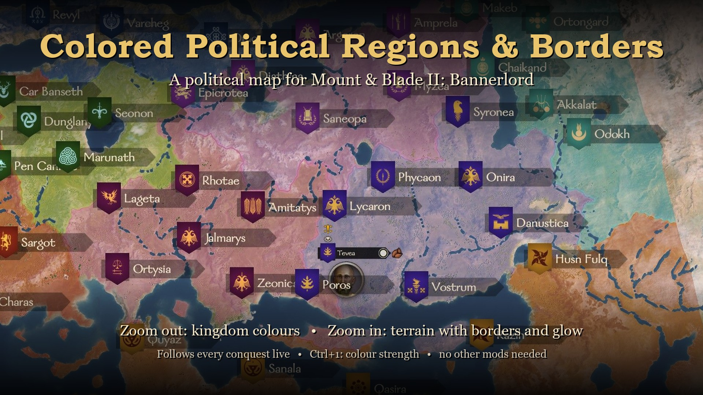
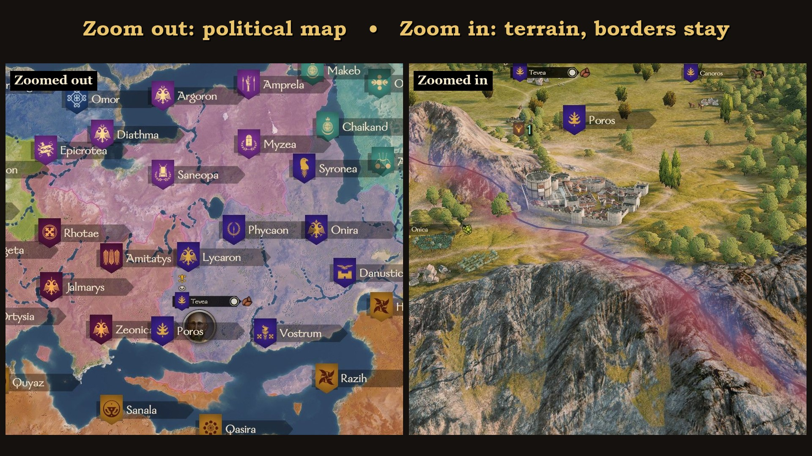
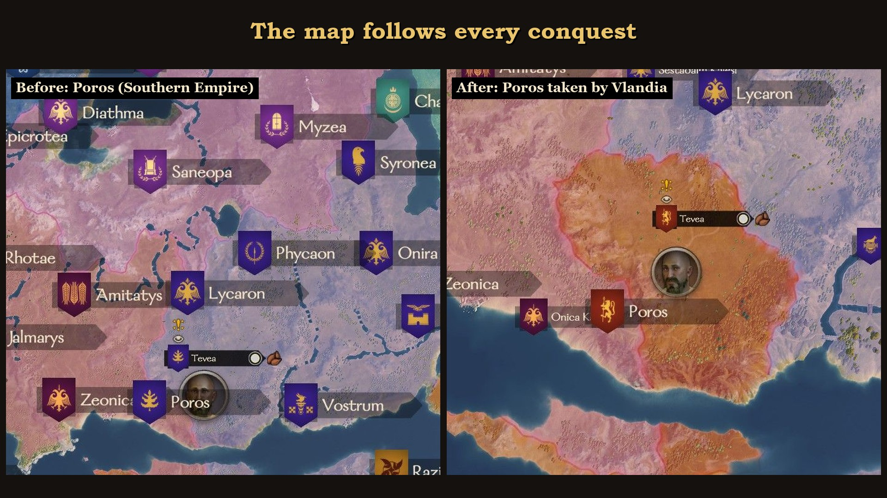
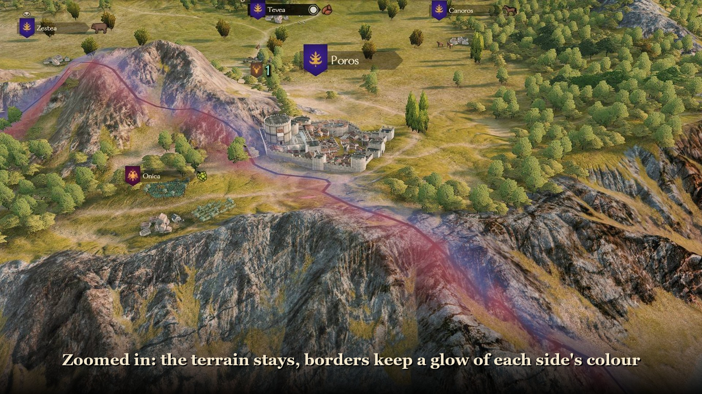
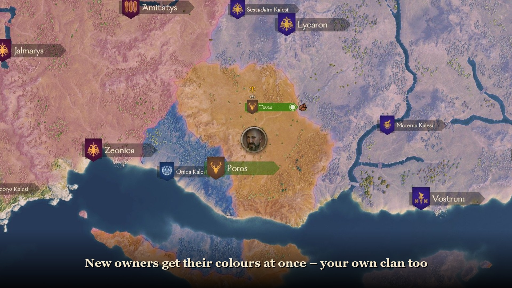

# Colored Political Regions & Borders – Bannerlord

**[Download the mod (zip)](https://github.com/champierr/Colored-Political-Regions-Borders-Bannerlord/releases/latest/download/ColoredPoliticalRegionsBorders_Bannerlord_v1.0.0.zip)**
 · [All downloads](https://github.com/champierr/Colored-Political-Regions-Borders-Bannerlord/releases/latest)
 · [Install video](https://github.com/champierr/Colored-Political-Regions-Borders-Bannerlord/releases/latest/download/cprb_bannerlord_install.mp4)
 · [Steam Workshop](https://steamcommunity.com/sharedfiles/filedetails/?id=3829655051)
 · [Nexus Mods](https://www.nexusmods.com/mountandblade2bannerlord/mods/14368)
 · [Warband version](https://github.com/champierr/Colored-Political-Regions-Borders)

> **Tested and stable on Bannerlord v1.4.8 (Steam), Sandbox campaign.** Other game versions, the War Sails
> DLC and other mods have not been tested yet; please
> [open an issue](https://github.com/champierr/Colored-Political-Regions-Borders-Bannerlord/issues) with how it
> works for you.

A political map for **Mount & Blade II: Bannerlord**. Every town, castle and village region on the campaign map
takes the colour of the kingdom (or clan) that owns it, and kingdoms are separated by a dark border line with a
soft glow of each side's colour. Zoomed out you see the political map; zoom in and the colour fades away to the
normal terrain while the borders and the glow stay.

- Colours are the game's own kingdom and clan colours (lifted a little when too dark to read on terrain).
- When a town or castle changes hands, the map recolours itself within a few seconds. New kingdoms, rebel
  clans and the player's clan get their colours too.
- **Ctrl+1** on the campaign map: colour strength (0-100 %), saved for every game.
- Follows the day and night light. Sea and lakes are left untouched.
- Does not change saved games and needs no other mod. Nothing is made for Calradia only: the map, the
  settlements, the coasts and the colours are read from the game while it runs.

## Install

**[Steam Workshop](https://steamcommunity.com/sharedfiles/filedetails/?id=3829655051):** subscribe, then tick the mod in the launcher.

**Manual ([GitHub](https://github.com/champierr/Colored-Political-Regions-Borders-Bannerlord/releases/latest) / [Nexus Mods](https://www.nexusmods.com/mountandblade2bannerlord/mods/14368))** – there is a [1.5 minute video](https://github.com/champierr/Colored-Political-Regions-Borders-Bannerlord/releases/latest/download/cprb_bannerlord_install.mp4):
1. Download the zip and extract it (right-click > *Extract All...*).
2. Open the game's `Modules` folder: Steam > Library > right-click *Mount & Blade II: Bannerlord* > Manage >
   Browse local files > `Modules`.
3. Copy the `ColoredPoliticalRegionsBorders` folder into `Modules`
   (`Modules\ColoredPoliticalRegionsBorders\SubModule.xml` must exist).
4. In the launcher: *Singleplayer* > *Mods*, tick **Colored Political Regions & Borders**, *Play*.
   A *CAUTION* window about unverified code is normal for mods with their own code: *Confirm*.
5. Start or load a campaign. "CPR&B: political map ready" appears at the bottom left after a few seconds.

**Uninstall:** untick the mod or delete the folder. Saves keep working (the game may say a mod is missing).

Settings and a log are in `Documents\Mount and Blade II Bannerlord\Configs\ColoredPoliticalRegionsBorders.txt`
and `.log`. Please attach the log to bug reports.

## Screenshots
| | |
|---|---|
|  |  |
|  |  |

## How it works
Bannerlord's shaders cannot be changed by a mod, and its map decals only show textures from the game's prebuilt
decal atlas, so the map is drawn with meshes laid just above the terrain, using two of the game's own
see-through materials unchanged:

1. `TerritoryBuilder` works out the territories off the main thread: every point belongs to the owner of the
   nearest settlement after a gentle warp (so borders are wavy, like the Warband version), the glow fades in
   from each border, and the borders are traced into line pieces.
2. `OverlayMeshes` builds the meshes with `MeshBuilder`, a few milliseconds per frame, and rebuilds only the
   parts whose colours changed:
   - **fill**: a map-wide grid that darkens the terrain by the coverage (a copy of `editor_map_border`, the
     multiplying material of the battle boundary walls) plus a second grid that adds the kingdom colour
     (`vertex_color_add_mat`); together a real blend. It fades in with the zoom.
   - **glow**: the same two passes on a finer grid near the borders.
   - **borders**: thin ribbons, prebuilt in a few widths; the one closest to the wanted on-screen width is shown.
3. `MapOverlay` samples the land and water once per map, checks ownership every second and drives the zoom
   fade, the day/night dimming and the border width every frame.

## Building from source
Needs the .NET SDK (8 or newer) and the game. The game folder defaults to the one in
`ColoredPoliticalRegionsBorders.csproj`; pass another one as shown below.

| Command | Does |
|---|---|
| `build_bannerlord.bat ["C:\...\Mount & Blade II Bannerlord"]` | Builds and copies the module into the game's `Modules` folder |
| `python tools/package.py ["C:\...\Mount & Blade II Bannerlord"]` | Release zip in `release/` and the Steam Workshop upload files in `release/workshop/` |
| `python tools/make_media.py` | Store images from `docs/screens/` |
| `python tools/make_video.py` | Install video (needs Pillow and imageio-ffmpeg) |

## Credits
Mount & Blade II: Bannerlord is by TaleWorlds Entertainment.

---

## Türkçe

**Colored Political Regions & Borders**, Bannerlord'un sefer haritasını politik harita gibi boyar. Her şehir, kale
ve köy bölgesi onu elinde tutan krallığın (ya da klanın) rengini alır; krallıklar arasında koyu bir sınır ve iki
yanında her tarafın kendi renginde hafif bir hüzme çizilir. Yakınlaşınca renk kaybolur ve normal arazi görünür;
sınırlar ve hüzme kalır. Bir şehir ya da kale el değiştirince harita birkaç saniye içinde kendiliğinden yeniden
boyanır.

**Test durumu:** Bannerlord v1.4.8 (Steam), Sandbox seferinde test edildi ve stabil. Diğer oyun sürümleri, War
Sails DLC'si ve diğer modlar henüz test edilmedi.

**Kurulum:** [Steam Atölyesi](https://steamcommunity.com/sharedfiles/filedetails/?id=3829655051)'nden abone ol ya da zip'i buradan veya [Nexus Mods](https://www.nexusmods.com/mountandblade2bannerlord/mods/14368)'tan indir, içindeki `ColoredPoliticalRegionsBorders`
klasörünü oyunun `Modules` klasörüne kopyala (Steam > Kütüphane > Bannerlord'a sağ tıkla > Yönet > Yerel dosyalara
göz at > `Modules`), launcher'da *Singleplayer* > *Mods* sekmesinde modu işaretle ve *Play*'e bas. Adım adım
[kurulum videosu](https://github.com/champierr/Colored-Political-Regions-Borders-Bannerlord/releases/latest/download/cprb_bannerlord_install.mp4)
ve zip'in içinde `HOW_TO_INSTALL.txt` var.

**Oyun içi ayar:** sefer haritasında **Ctrl+1** ile renk gücünü %0-100 arası ayarlayabilirsin; ayar her oyun için
kaydedilir.
